# Менеджер конференцій для OJS: покроковий посібник

Посібник показує повний цикл заходу в плагіні «Менеджер конференцій» (версія 0.32.1, OJS 3.5): від профілю закладу до сертифікатів і звітів. Кожен крок має знімок екрана й перелік того, що саме заповнити.

Плагін підходить для будь-якого закладу-організатора: закладу вищої освіти, коледжу, ІППО, наукової установи, МАН, громадської організації. Усі назви, суми й реквізити на знімках вигадані для прикладу (заклад «Державний університет «Приклад»», конференція «Наука й освіта: виклики сьогодення 2027»). Замініть їх своїми.

Той самий шлях без знімків, з усіма подробицями, описано в посібниках [менеджера](manager.md), [реєстраційного менеджера](registration-manager.md), [учасника](participant.md) і [рецензента](reviewer.md).

## Зміст

- [Хто що робить і в якому порядку](#хто-що-робить-і-в-якому-порядку)
- [Частина 1. Менеджер журналу й оргкомітет](#частина-1-менеджер-журналу-й-оргкомітет)
  - [1. Профіль закладу-організатора](#1-профіль-закладу-організатора)
  - [2. Майстер налаштування: перше видання](#2-майстер-налаштування-перше-видання)
  - [3. Перевірка видання й відкриття прийому заявок](#3-перевірка-видання-й-відкриття-прийому-заявок)
  - [4. Категорії учасників і тарифи](#4-категорії-учасників-і-тарифи)
  - [5. Правила оплати](#5-правила-оплати)
  - [6. Місця й промокоди](#6-місця-й-промокоди)
  - [7. Реєстраційний менеджер](#7-реєстраційний-менеджер)
  - [8. Вибір подань рецензентами](#8-вибір-подань-рецензентами)
  - [9. Рецензування й рішення щодо тез](#9-рецензування-й-рішення-щодо-тез)
  - [10. Квитанції, рахунки й оплати](#10-квитанції-рахунки-й-оплати)
  - [11. Розсилки й нагадування](#11-розсилки-й-нагадування)
  - [12. Програма заходу](#12-програма-заходу)
  - [13. Присутність](#13-присутність)
  - [14. Сертифікати й свідоцтва](#14-сертифікати-й-свідоцтва)
  - [15. Збірник тез](#15-збірник-тез)
  - [16. Підсумки, звіти й експорт для бухгалтерії](#16-підсумки-звіти-й-експорт-для-бухгалтерії)
  - [17. Публічна частина: сайт конференцій](#17-публічна-частина-сайт-конференцій)
- [Частина 2. Учасник: автор і слухач](#частина-2-учасник-автор-і-слухач)
- [Частина 3. Рецензент](#частина-3-рецензент)
- [Шпаргалка: що заповнити обов'язково](#шпаргалка-що-заповнити-обовязково)
- [Типові проблеми](#типові-проблеми)

## Хто що робить і в якому порядку

| Етап | Менеджер / оргкомітет | Учасник | Рецензент |
|---|---|---|---|
| Підготовка | Профіль закладу, майстер, видання, тарифи, правила оплати, промокоди | | |
| Прийом заявок | Відкриває прийом, відкриває вибір рецензентами | Реєструє обліковий запис, подає тези або реєструється слухачем | Позначає, які подання хоче рецензувати |
| Рецензування | Надсилає на рецензування, призначає рецензентів, ухвалює рішення | Отримує лист із рішенням і рахунок | Приймає запит, пише рецензію |
| Оплата | Перевіряє квитанції, записує оплати, звільнення | Завантажує рахунок, платить, надсилає квитанцію | |
| Захід | Програма, розсилки, присутність | Програма, вхідний QR-квиток, лист-запрошення | |
| Після заходу | Сертифікати, збірник тез, звіти, експорт для бухгалтерії | Завантажує сертифікат | Отримує подяку |

Основні адреси (замість `{журнал}` підставте шлях свого журналу):

- керування заходами: `/{журнал}/manageConference` (пункт **Конференції** у бічному меню);
- усі заходи журналу (пункт **Конференції** у головному меню сайту): `/{журнал}/conference`;
- публічна сторінка заходу: `/{журнал}/conference/{адреса заходу}`;
- кабінет учасника: `/{журнал}/conference/my`;
- перевірка сертифіката: `/{журнал}/conference/verify`.

---

# Частина 1. Менеджер журналу й оргкомітет

## 1. Профіль закладу-організатора

**Де:** **Налаштування → Вебсайт → Плагіни**, розгорніть «Менеджер конференцій» і натисніть **Профіль закладу-організатора**. Профіль заповнюється один раз для журналу. Звідси дані потрапляють у рахунки, сертифікати, листи-запрошення й на публічні сторінки.

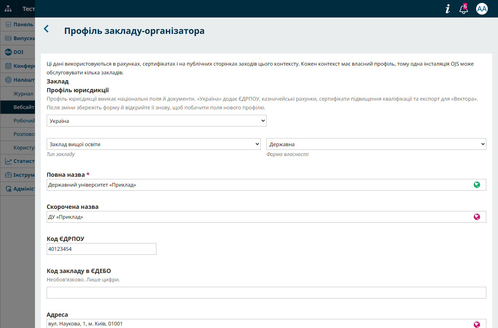

**Розділ «Заклад»:**

| Поле | Що вписати |
|---|---|
| Профіль юрисдикції | «Україна» (додає ЄДРПОУ, казначейські рахунки, свідоцтва про підвищення кваліфікації, експорт для «Вектора») або «Без національних правил». Після зміни збережіть і відкрийте форму знову. |
| Тип закладу, Форма власності | Ваш тип: від нього залежать запропоновані набори в майстрі. |
| Повна назва, Скорочена назва | Офіційна назва всіма мовами журналу (перемикач мови біля поля). |
| Код ЄДРПОУ | 8 цифр, контрольна цифра перевіряється. |
| Код закладу в ЄДЕБО | Необов'язково. |
| Адреса, Контактний email, Вебсайт | Друкуються в рахунку й листі-запрошенні. |
| Повідомлення про обробку персональних даних | Текст згоди для учасників. Порожнє поле означає типовий текст плагіна. Для профілю «Україна» є приклад, який варто погодити з юристом. |
| Відповідальний за персональні дані, Строки зберігання | Контакт і строк, які бачить учасник. |

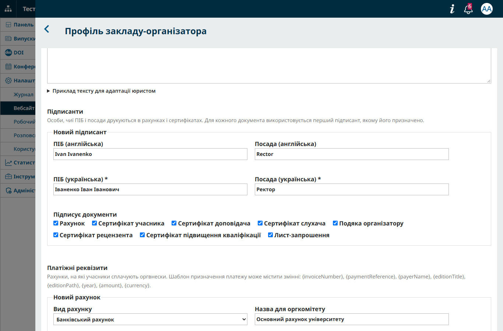

**Розділ «Підписанти».** Натисніть **Новий підписант**, впишіть **ПІБ** і **Посаду** (українською обов'язково, англійською для англомовних документів) і позначте, що ця людина підписує: рахунок, сертифікати потрібних видів, свідоцтво про підвищення кваліфікації, лист-запрошення. Для кожного документа друкується перший підписант, якому його призначено.

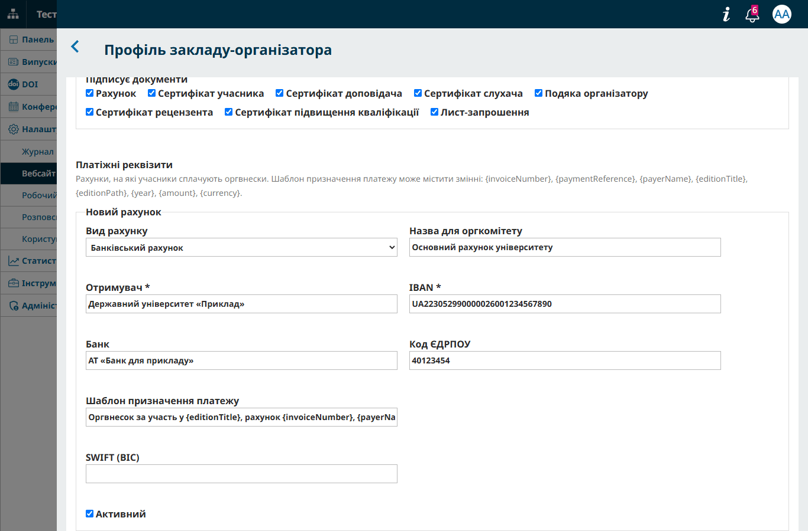

**Розділ «Платіжні реквізити».** Натисніть **Новий рахунок**:

- **Вид рахунку:** банківський, казначейський або рахунок співорганізатора;
- **Назва для оргкомітету:** щоб розрізняти рахунки в налаштуваннях;
- **Отримувач**, **IBAN** (для України UA і 29 символів, контрольна сума перевіряється), **Банк**, **Код ЄДРПОУ**, за потреби **SWIFT**;
- для казначейського рахунку також код класифікації доходів, КПКВ і примітка для платника;
- **Шаблон призначення платежу** зі змінними, наприклад `Оргвнесок за участь у {editionTitle}, рахунок {invoiceNumber}, {payerName}`;
- позначка **Активний**: лише активні рахунки можна обрати в правилах оплати.

**Розділ «Подання».** Позначка **Журнал приймає й звичайні статті** дає авторам вибір «Не для конференції». Якщо журнал лише конференційний, зніміть її.

Натисніть **OK**, щоб зберегти.

> Порада. Спершу додайте хоча б один активний рахунок, а вже потім запускайте майстер. Без рахунку майстер не створить правил оплати переказом.

## 2. Майстер налаштування: перше видання

**Де:** пункт **Конференції** в бічному меню. Якщо видань ще немає, майстер відкривається сам. Інакше натисніть **Майстер налаштування** вгорі сторінки.

**Крок 1. Тип закладу.** Поле вже заповнене з профілю. Натисніть **Далі**.

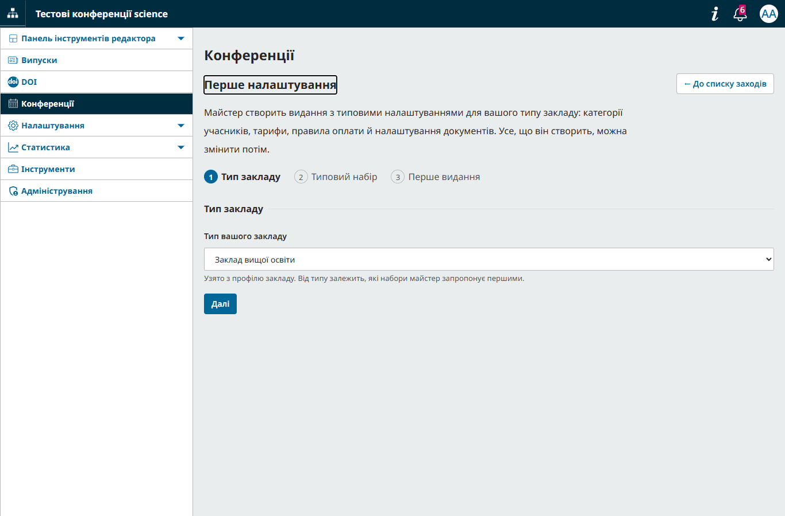

**Крок 2. Типовий набір.** Оберіть набір кнопкою **Обрати**. Картка показує, що буде створено: тип заходу, формат, режими подання й публікації, кількість категорій і тарифів. Набори для вашого типу закладу йдуть першими, набори на сірому тлі розраховані на інші заклади, але їх теж можна взяти.

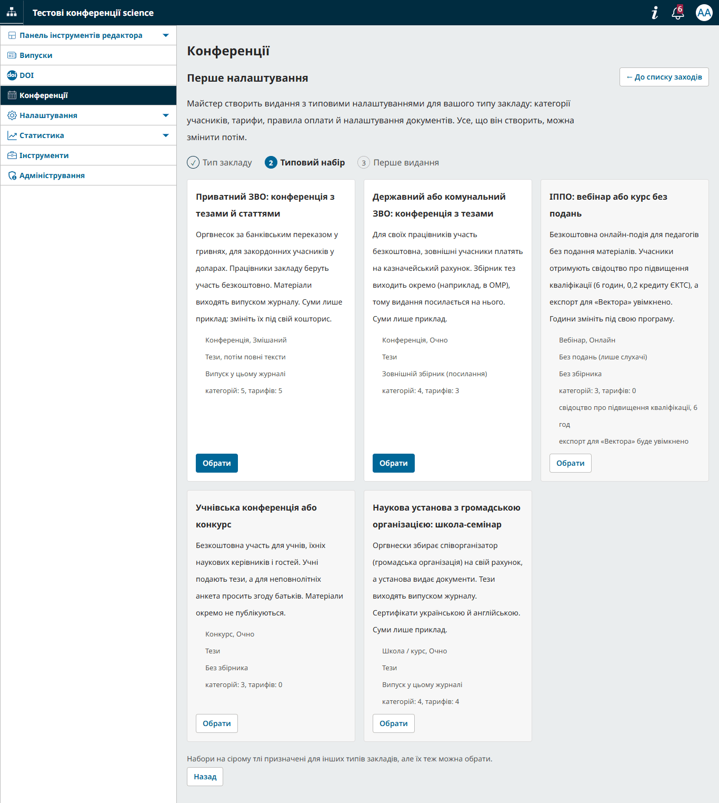

**Крок 3. Перше видання.** Майстер показує, які категорії, тарифи й правила оплати буде створено. Заповніть:

- **Назва** (українською обов'язково, англійською бажано);
- **Адреса сторінки**: латиниця, цифри, дефіс, наприклад `science-2027`;
- **Початок** і **Завершення** заходу;
- **Початок прийому заявок**, **Кінцевий термін подання тез**, **Кінцевий термін повних текстів** (лише для режиму «тези, потім тексти»), **Завершення реєстрації**.

Дати вводяться за часовим поясом, який показано під полями.

Позначку **Оформити публічну частину журналу як сайт конференцій** залиште, якщо журнал служить сайтом конференцій: тексти OJS говоритимуть про конференцію, а не журнал, а в головному меню з'явиться пункт **Конференції** (докладніше в [кроці 17](#17-публічна-частина-сайт-конференцій)). Зніміть її, якщо журнал публікує й звичайні випуски. Натисніть **Створити видання**.

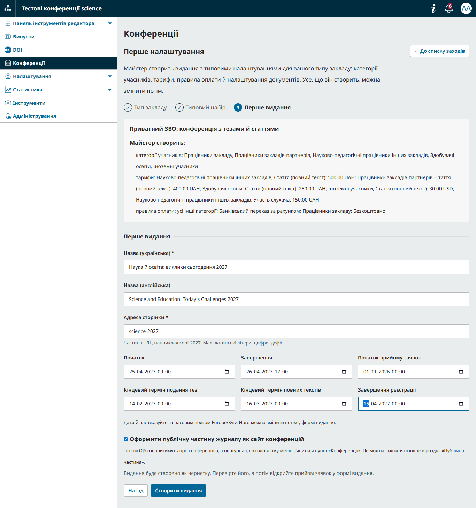

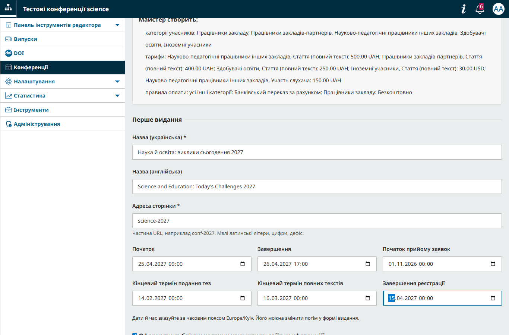

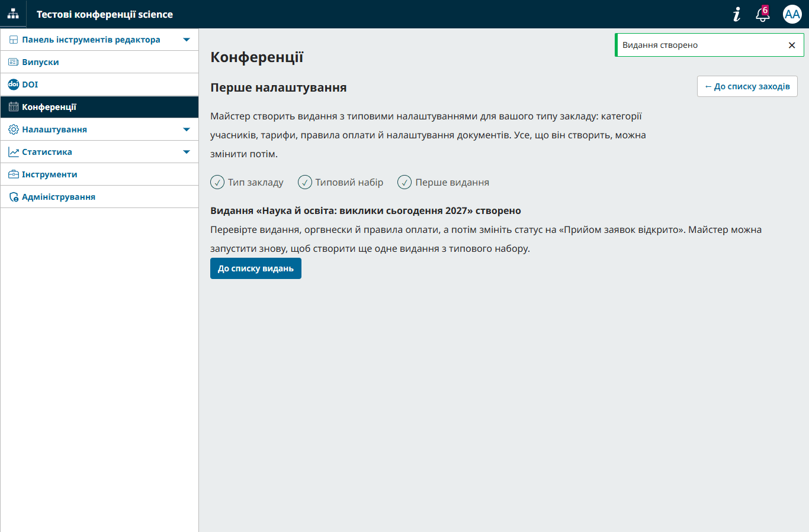

Видання створюється як **чернетка**. Суми в наборах наведено лише як приклад, тож обов'язково перевірте тарифи (крок 4).

## 3. Перевірка видання й відкриття прийому заявок

**Де:** у списку натисніть **Відкрити** біля видання, потім **Редагувати** на панелі розділів видання.

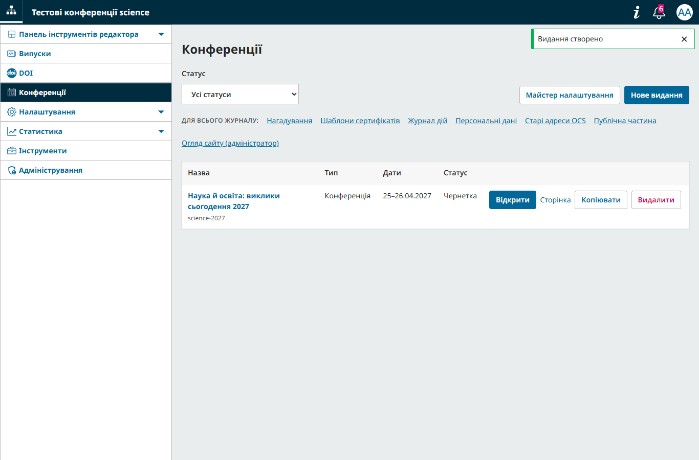

Панель **Розділи видання** згрупована так: **Загальне** (Підсумки, Редагувати), **Учасники** (Учасники, Розсилки, Сертифікати), **Гроші** (Оргвнески, Оплата, Рахунки, Квитанції, Місця й промокоди), **Подання й програма** (Рішення, Вибір рецензентами, Програма, Збірник тез, Партнери).

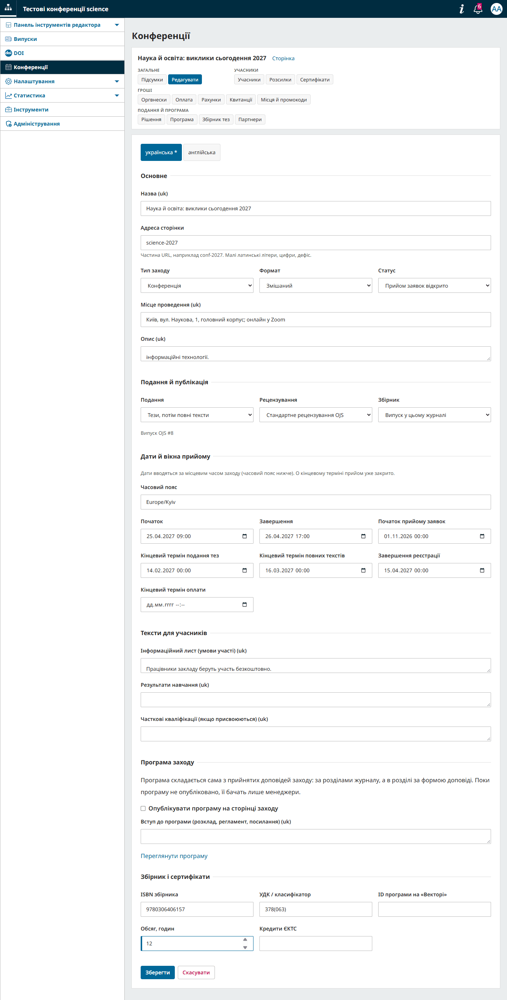

Що перевірити й заповнити у формі видання:

| Розділ | Поля |
|---|---|
| Основне | **Тип заходу**, **Формат** (очно, онлайн, змішаний), **Статус**, **Місце проведення**, **Опис**. |
| Подання й публікація | **Подання**: без подань, тези, або тези, потім повні тексти. **Рецензування**: спрощене (рішення одразу на етапі подання), двоетапне або стандартне рецензування OJS. **Збірник**: без збірника, випуск у цьому журналі або зовнішній збірник за посиланням. |
| Дати й вікна прийому | Ті самі дати, що в майстрі, плюс **Кінцевий термін оплати**. |
| Тексти для учасників | **Інформаційний лист (умови участі)**, **Результати навчання**, **Часткові кваліфікації**. |
| Програма заходу | Позначка публікації програми (див. крок 12). |
| Збірник і сертифікати | **ISBN збірника**, **УДК**, **Обсяг, годин** і **Кредити ЄКТС** (якщо вказано години, слухачі отримують свідоцтво про підвищення кваліфікації), **ID програми на «Векторі»**. |

**Щоб відкрити прийом,** змініть **Статус** на «Прийом заявок відкрито» і натисніть **Зберегти**. Сам прийом не відкривається: статус треба поставити вручну. Подання реально приймаються лише між початком прийому й кінцевим терміном. Після дедлайну тез планувальник OJS сам переведе видання в «Прийом заявок закрито».

Кнопка **Сторінка** біля видання відкриває публічну сторінку заходу (як її бачать учасники, див. [частину 2](#2-сторінка-заходу)).

## 4. Категорії учасників і тарифи

**Де:** розділи видання → **Оргвнески**.

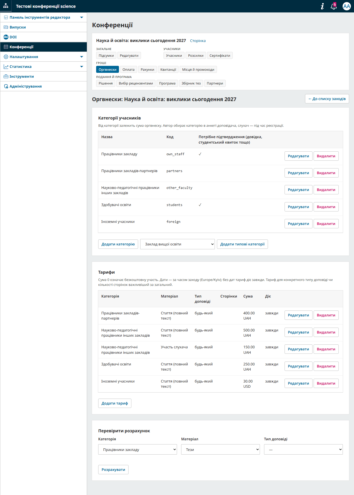

**Категорії учасників.** Від категорії залежить сума оргвнеску. Майстер уже додав типовий набір. Щоб додати ще, натисніть **Додати категорію** і вкажіть **Назву**, **Код** для звітів і, за потреби, **Потрібне підтвердження** (довідка, студентський квиток). Кнопка **Додати типові категорії** бере набір для вибраного типу закладу.

**Тарифи.** Натисніть **Додати тариф** і заповніть:

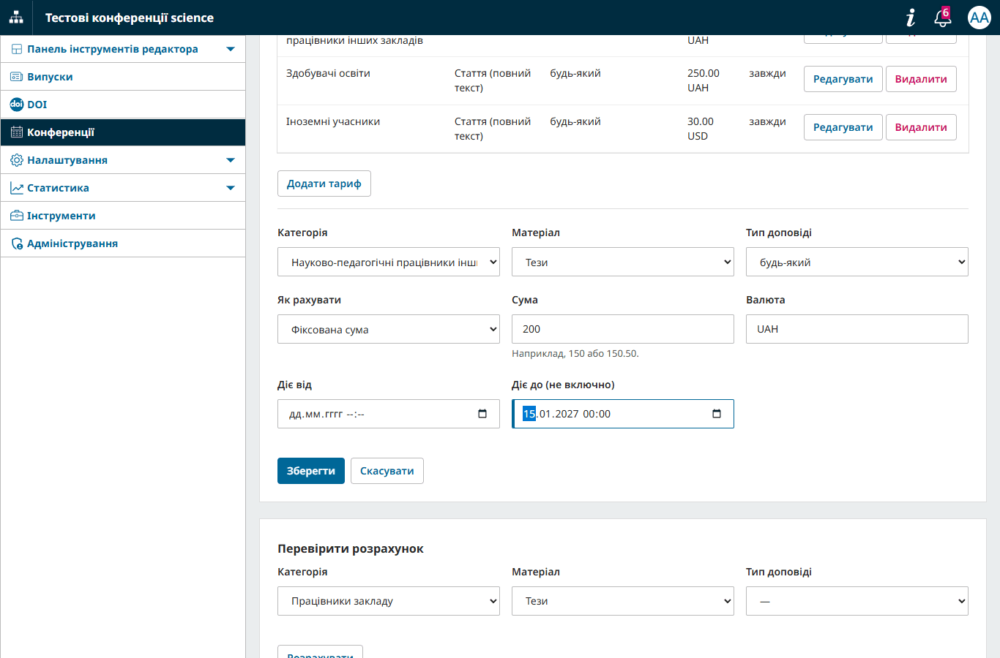

- **Категорія** і **Матеріал**: тези, стаття (повний текст), участь слухача або будь-який;
- **Тип доповіді**: будь-який або конкретний (усна, стендова, онлайн, заочна);
- **Як рахувати**: фіксована сума або за сторінку (для статей можна задати діапазон сторінок);
- **Сума** і **Валюта** (UAH, USD, EUR);
- **Діє від** і **Діє до (не включно)**, наприклад для пільгової ціни за ранню реєстрацію. Без дат тариф діє завжди.

Сума 0 означає безкоштовну участь. Якщо підходить кілька тарифів, діє найточніший: з конкретним типом доповіді, з діапазоном сторінок, з датами.

**Перевірка.** У блоці **Перевірити розрахунок** оберіть категорію, матеріал і тип доповіді та натисніть **Розрахувати**.

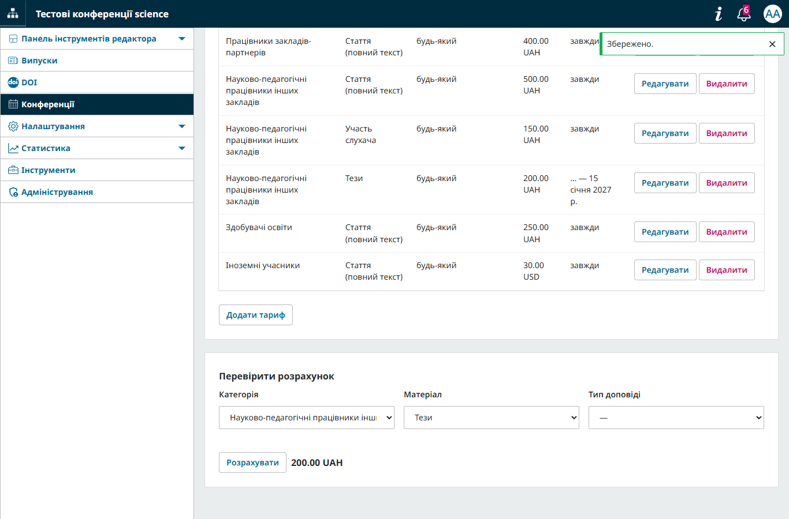

> Перевірте, що для кожної платної категорії є тариф на той матеріал, який вона подаватиме. Якщо тарифу немає, рахунок не виставиться.

## 5. Правила оплати

**Де:** розділи видання → **Оплата**.

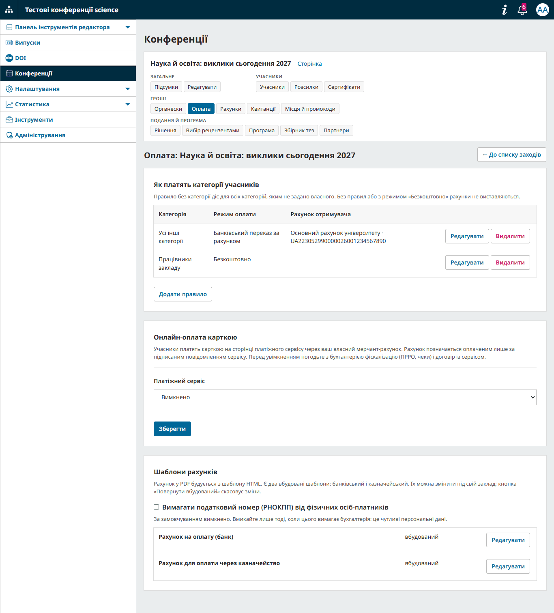

Правило визначає, як платить категорія. Натисніть **Додати правило**:

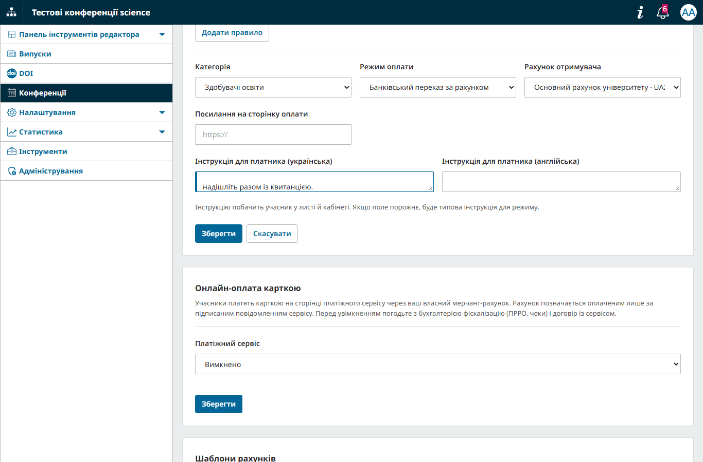

1. **Категорія**: конкретна або «Усі інші категорії» (загальне правило може бути лише одне, правило категорії важливіше за нього).
2. **Режим оплати**: «Безкоштовно», «Банківський переказ за рахунком», «Переказ через казначейство», «Платить співорганізатор», «Оплата на зовнішній сторінці», «Оплата карткою онлайн».
3. **Рахунок отримувача** з профілю закладу (для переказів).
4. **Посилання на сторінку оплати** (лише для зовнішньої сторінки, `https://`).
5. **Інструкція для платника** українською й англійською. Порожнє поле означає типову інструкцію.

Нижче на сторінці:

- **Онлайн-оплата карткою.** Спільне налаштування журналу: оберіть сервіс (LiqPay), вставте ключі, для перевірки увімкніть тестовий режим. Перед цим погодьте з бухгалтерією фіскалізацію (ПРРО) і договір із сервісом.
- **Шаблони рахунків.** Вбудовані банківський і казначейський шаблони можна змінити під свій бланк.
- **Вимагати податковий номер (РНОКПП)** вмикайте лише на вимогу бухгалтерії.

## 6. Місця й промокоди

**Де:** розділи видання → **Місця й промокоди**.

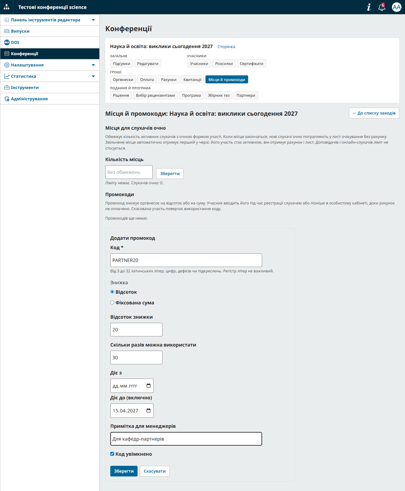

- **Кількість місць** обмежує лише слухачів очно. Коли місця закінчаться, нові слухачі потрапляють у лист очікування без рахунку, а звільнене місце автоматично отримує перший у черзі. Порожнє поле означає «без обмежень».
- **Додати промокод**: **Код** (латиниця, від 3 символів, регістр не важливий), **Знижка** (відсоток або сума), **Скільки разів можна використати**, **Діє з / до**, **Примітка для менеджерів** (кому видано), позначка **Код увімкнено**.

Учасник вводить код під час реєстрації слухачем або пізніше в кабінеті, поки рахунок не оплачено. У рахунку біля внеску видно код і повну вартість (див. [рахунок слухача](#5-кабінет-учасника-рахунок-і-оплата)).

## 7. Реєстраційний менеджер

Щоб облік учасників і перевірку оплат вела окрема людина, відкрийте **Налаштування → Користувачі та ролі**, знайдіть користувача й додайте йому роль **Реєстраційний менеджер**. Він бачить **Учасники**, **Рахунки**, **Квитанції**, **Місця й промокоди**, **Підсумки**, **Розсилки** і **Сертифікати**, але не змінює видання, тарифи, правила оплати й шаблони і не ухвалює рішень щодо подань.

## 8. Вибір подань рецензентами

Доступно в режимах рецензування «стандартне» і «двоетапне». Рецензенти самі позначають, що хочуть рецензувати, а плагін пропонує розподіл.

**Де:** розділи видання → **Вибір рецензентами**.

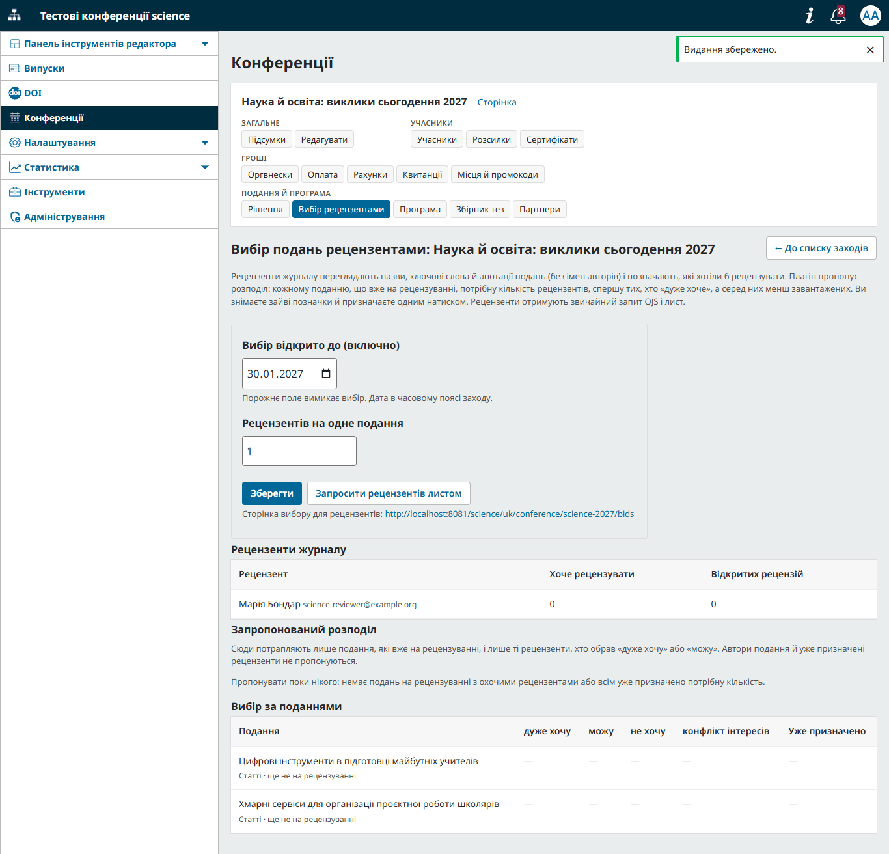

1. Вкажіть **Вибір відкрито до (включно)** і **Рецензентів на одне подання** (від 1 до 10). Натисніть **Зберегти**. Порожня дата вимикає вибір.
2. Натисніть **Запросити рецензентів листом**. Кожен рецензент журналу отримає посилання на сторінку вибору. Те саме посилання видно на екрані, його можна надіслати іншим способом.
3. Рецензенти позначають подання (див. [частину 3](#частина-3-рецензент)).
4. Надішліть подання на рецензування (крок 9). Блок **Запропонований розподіл** покаже пари «подання — рецензент» для подань, які вже на рецензуванні.

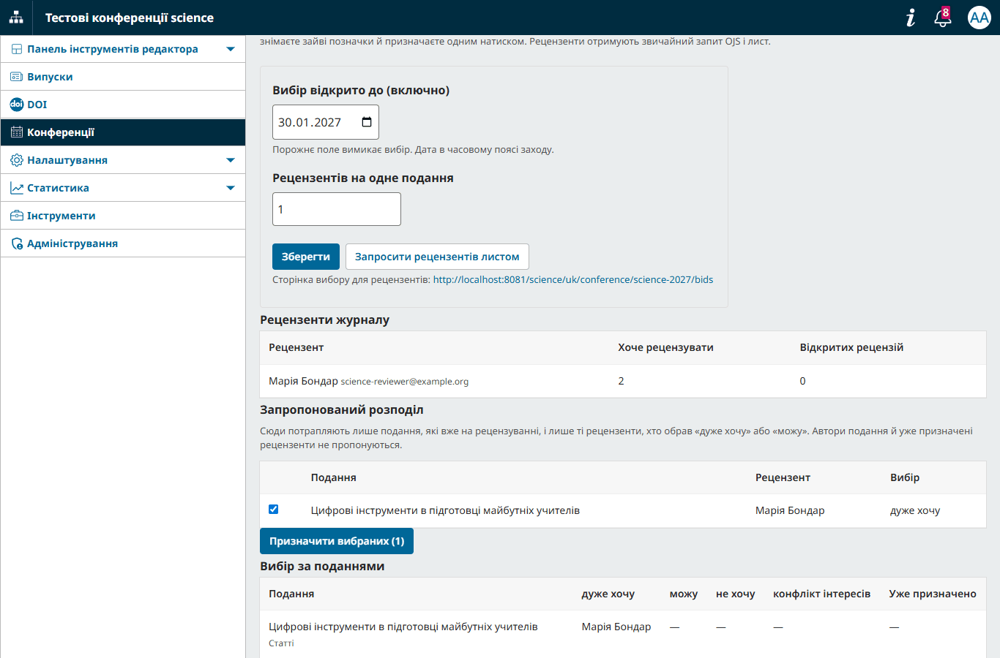

5. Зніміть позначки з пар, які не підходять, і натисніть **Призначити вибраних**. Рецензенти отримають звичайний запит OJS на рецензію.

Таблиця **Рецензенти журналу** показує, скільки подань хоче кожен і скільки рецензій у нього вже відкрито.

## 9. Рецензування й рішення щодо тез

### Картка подання

Відкрийте подання з **Панелі інструментів редактора**. На етапі «Подання» поряд зі стандартними кнопками OJS є чотири кнопки плагіна: **Прийняти: усна доповідь**, **стендова**, **онлайн-доповідь**, **заочна участь (лише публікація)**. Праворуч панель **Участь у заході**: захід, бажаний тип виступу, учасники й стан підтвердження, рахунок.

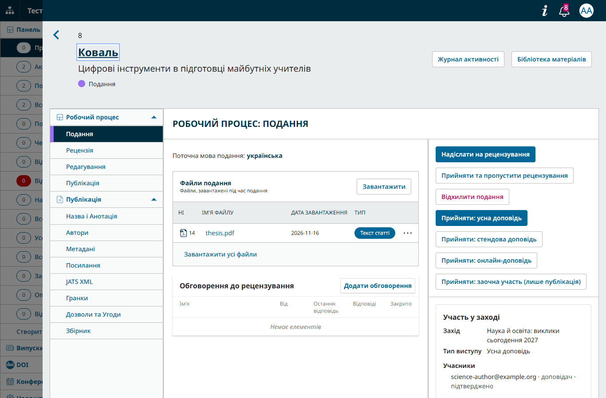

- **Спрощений режим:** ухвалюйте рішення одразу кнопками «Прийняти: …».
- **Стандартний режим:** натисніть **Надіслати на рецензування**, призначте рецензентів (вручну кнопкою **Додати рецензента** або через [вибір рецензентами](#8-вибір-подань-рецензентами)), дочекайтеся рецензії й натисніть **Направити на редагування**.

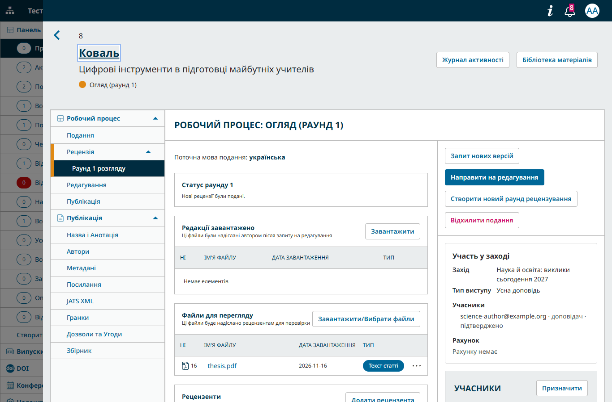

Кожне рішення відкриває стандартну сторінку OJS із листом автору, який можна відредагувати або пропустити.

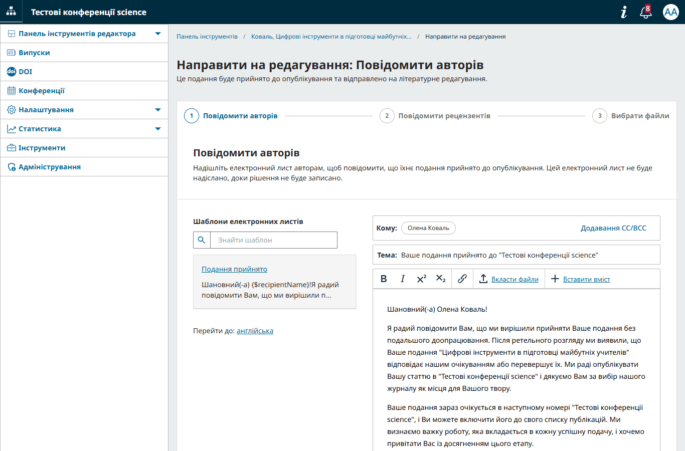

Після прийняття тип виступу записується в подання, матеріал потрапляє до випуску заходу, **доповідачеві автоматично виставляється рахунок** за тарифом його категорії, автор отримує лист.

### Масові рішення

**Де:** розділи видання → **Рішення**. Тут подання, які чекають першого рішення.

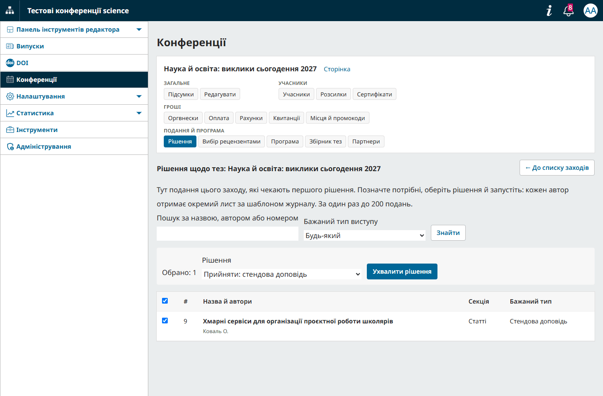

1. Знайдіть потрібні подання (пошук, фільтри **Бажаний тип виступу**, **Секція**, кнопка **Знайти**).
2. Позначте їх або натисніть **Обрати всі**.
3. У полі **Рішення** оберіть одне з «Прийняти: …» або «Відхилити».
4. Натисніть **Ухвалити рішення** і підтвердьте. Скасувати це не можна.

За раз до 200 подань. Кожен автор отримує окремий лист. Перебіг і результат видно в **Останні запуски**.

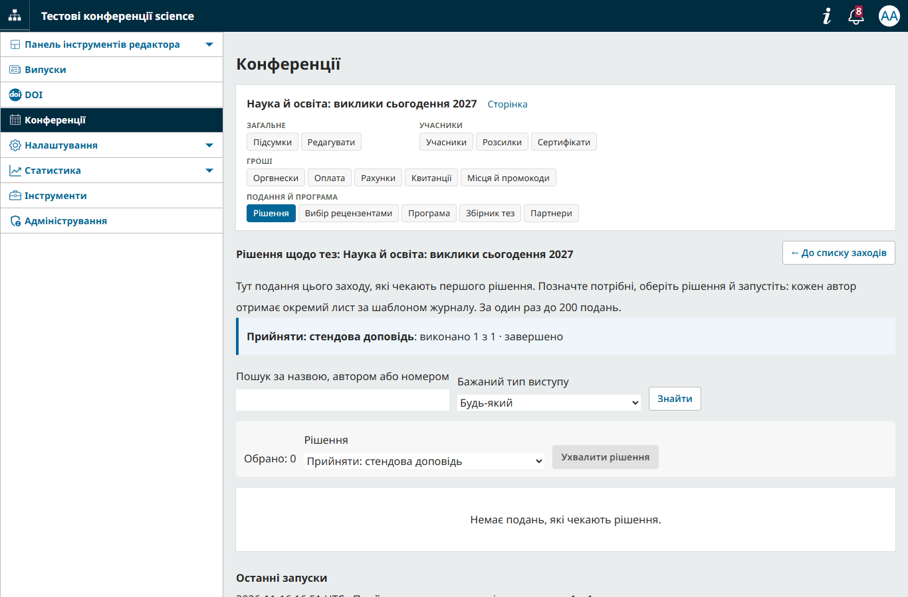

Тексти всіх листів плагіна змінюються в **Налаштування → Робочий процес → Листи**.

## 10. Квитанції, рахунки й оплати

### Квитанції

**Де:** розділи видання → **Квитанції**, вкладка **Очікують перевірки**.

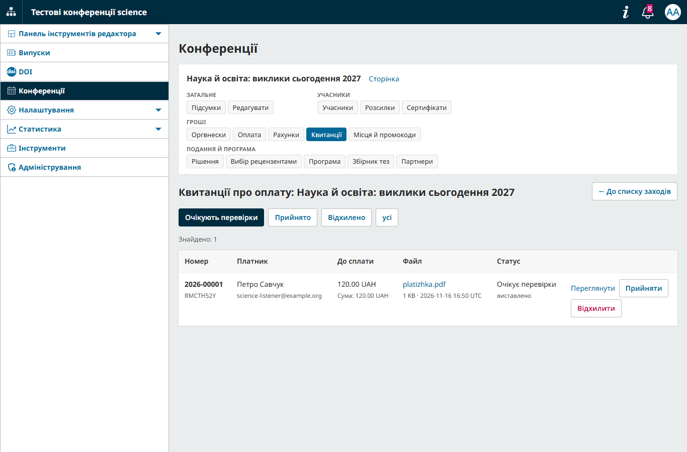

1. Натисніть **Переглянути**: файл відкриється в новій вкладці.
2. Звірте суму у файлі зі стовпцем **До сплати**.
3. **Прийняти** позначає рахунок оплаченим і надсилає платнику лист. **Відхилити** просить коротку причину, учасник побачить її й зможе надіслати іншу квитанцію.

Якщо сплачено менше, ніж треба, не приймайте квитанцію, а запишіть часткову оплату в **Рахунках**.

### Рахунки

**Де:** розділи видання → **Рахунки**. Пошук за номером, кодом платежу або поштою, фільтр за статусом.

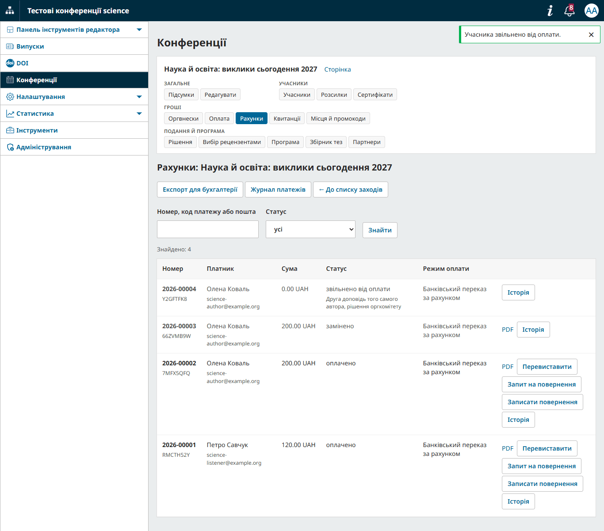

Дії з рахунком:

- **Оплачено**: впишіть отриману суму. Менша сума запишеться як часткова оплата.
- **Звільнити**: впишіть причину (її побачить учасник). Старий рахунок стає «замінено», створюється рахунок на 0.
- **Перевиставити**: новий рахунок за чинним тарифом, якщо змінилась категорія чи тип виступу. Сплачене переноситься.
- **Скасувати** (лише неоплачений), **PDF**, **Історія**.
- Для оплачених: **Запит на повернення** і **Записати повернення**.

Рахунок слухачу виставляється одразу після реєстрації, доповідачу після прийняття тез. Номери йдуть без пропусків у межах журналу й року (`2026-00001`).

**Груповий рахунок** (одна організація платить за кількох) і **Запросити учасника** (без оргвнеску) запускаються з реєстру **Учасники**.

> OJS не опублікує матеріал заходу, доки рахунок доповідача не оплачено або доповідача не звільнено від оплати.

## 11. Розсилки й нагадування

**Розсилки.** Розділи видання → **Розсилки**.

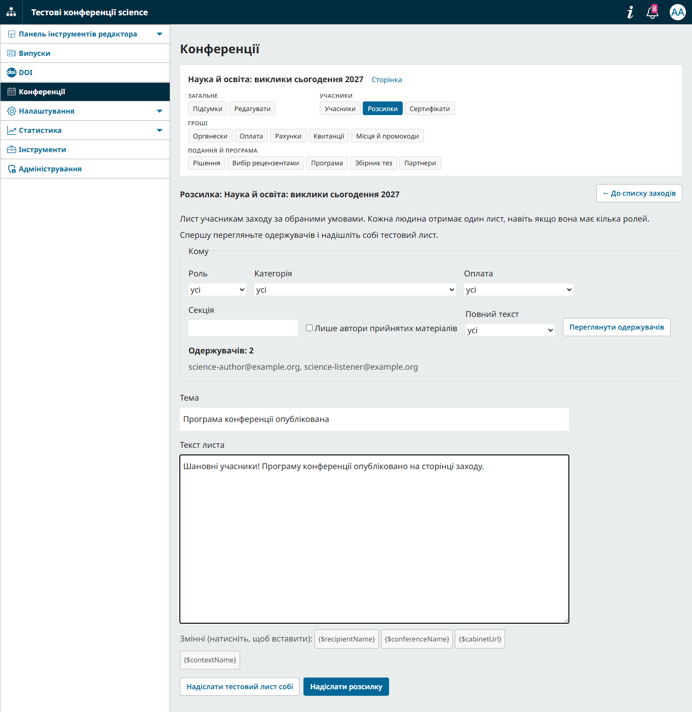

1. У блоці **Кому** оберіть умови (роль, категорія, оплата, секція, лише автори прийнятих матеріалів, повний текст).
2. Натисніть **Переглянути одержувачів**.
3. Заповніть **Тему** і **Текст листа**, змінні вставляються натиском.
4. **Надіслати тестовий лист собі**, перевірте, потім **Надіслати розсилку**.

**Нагадування.** На сторінці **Конференції** натисніть **Нагадування** (рядок «Для всього журналу»).

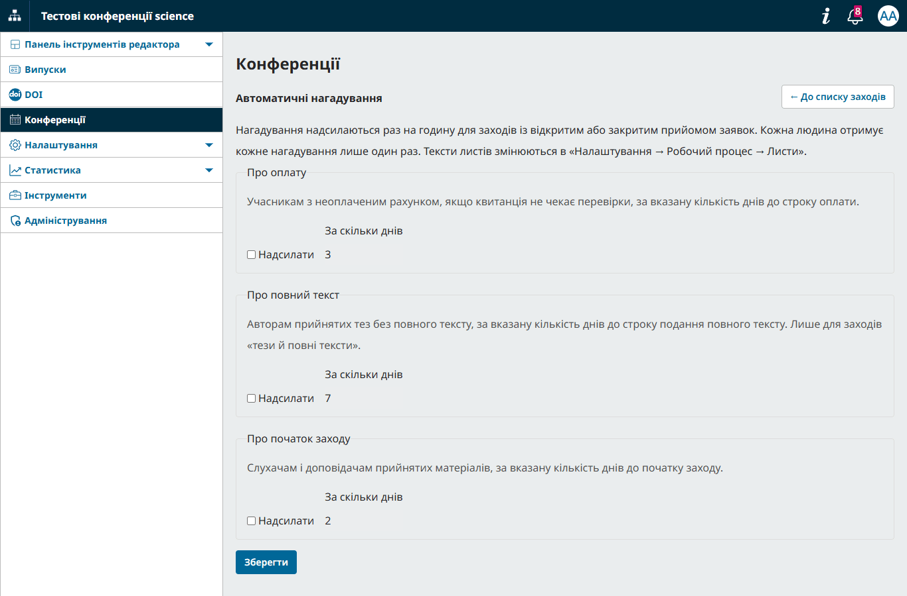

Три види: про оплату, про повний текст, про початок заходу. Для кожного поставте **Надсилати** і **За скільки днів**. За замовчуванням усі вимкнені. Без планувальника OJS (cron) нагадування не надсилаються.

## 12. Програма заходу

**Де:** розділи видання → **Програма**.

**1. Зали.** Розгорніть **Зали** і натисніть **Додати зал**: **Назва залу**, **Місткість**, **Посилання для онлайн-участі** (Zoom, Teams, Meet). Посилання зали стає посиланням на трансляцію всіх її сесій.

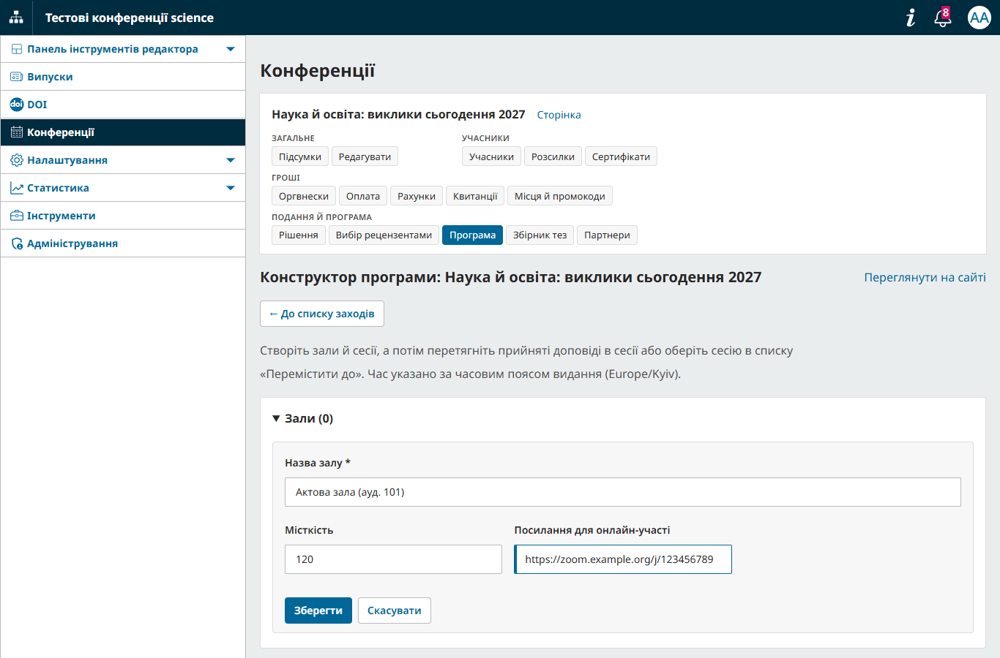

**2. Сесії.** Натисніть **Додати сесію**: **Тип сесії** (пленарне, секційне, стендова сесія, семінар, перерва), **Назва**, **Зал**, **Початок**, **Завершення**, **Тривалість доповіді за замовчуванням**, **Модератори** (пошук серед учасників заходу), за потреби **Опис** і окреме **Посилання на трансляцію**. Для семінару можна вказати години й кредити ЄКТС.

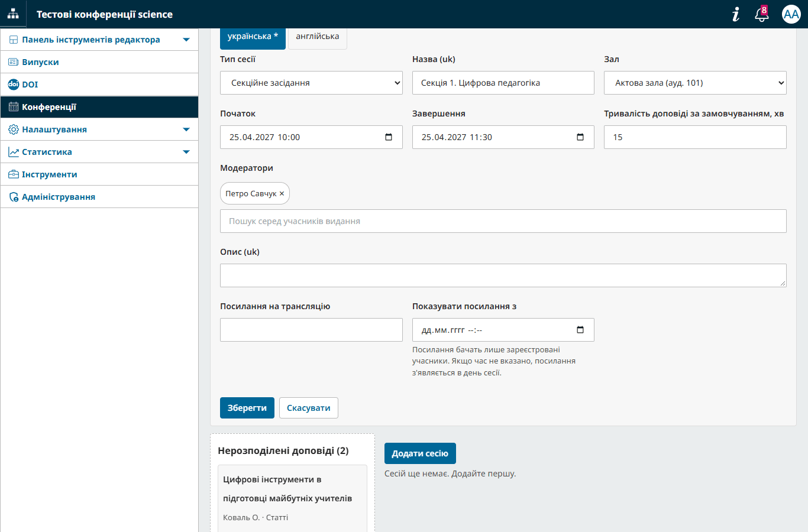

**3. Розподіл доповідей.** Перетягніть доповіді з колонки **Нерозподілені доповіді** в сесію або оберіть сесію в списку **Перемістити до**. Стрілки змінюють порядок, поле «хв» задає тривалість окремої доповіді. Конструктор попереджає, якщо зал зайнятий, доповіді не вміщаються або доповідач виступає у двох місцях одночасно.

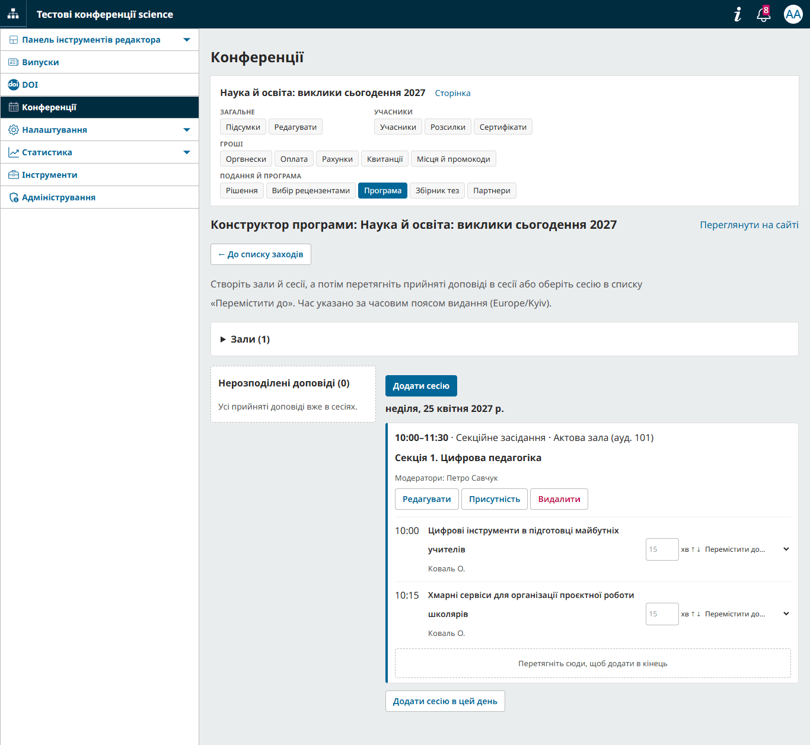

**4. Публікація.** **Редагувати** → розділ **Програма заходу**: за потреби заповніть **Вступ до програми**, перегляньте чернетку посиланням **Переглянути програму**, поставте **Опублікувати програму на сторінці заходу** і натисніть **Зберегти**.

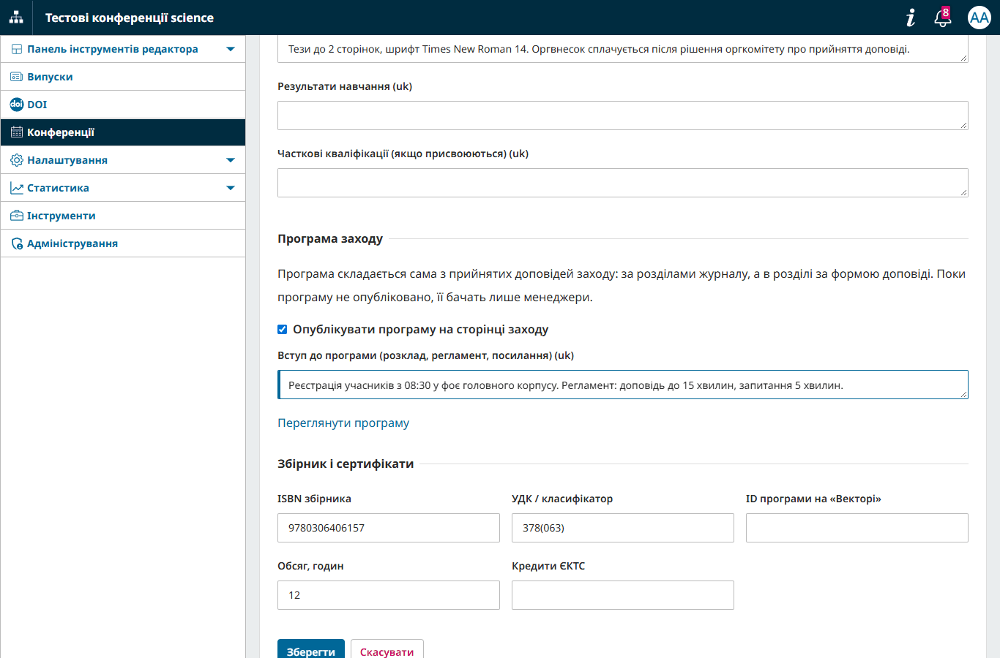

Як програму бачать учасники, див. [частину 2](#7-програма-й-модерування-сесії).

## 13. Присутність

**Де:** розділи видання → **Учасники**.

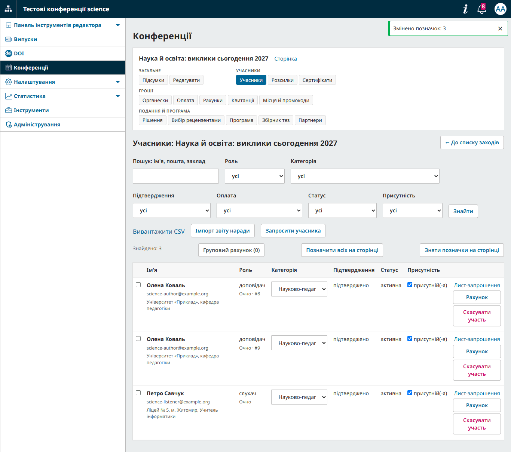

Реєстр має пошук і фільтри (роль, категорія, підтвердження, оплата, статус, присутність), кнопку **Вивантажити CSV**. Присутність можна позначити:

- **вручну**: позначки в стовпці **Присутність** або **Позначити всіх на сторінці**;
- **за звітом онлайн-наради**: **Імпорт звіту наради**, оберіть CSV з Teams, Zoom чи Meet, вкажіть **Поріг, хвилин**, натисніть **Переглянути**, потім **Застосувати**. Учасників знаходимо за поштою, ручні позначки імпорт не знімає;
- **за QR-квитком на вході**: відскануйте квиток учасника телефоном, на якому ви увійшли в журнал, і натисніть **Відмітити присутність**;
- **на окремій сесії**: у конструкторі програми кнопка **Присутність** біля сесії. Модератор сесії робить це сам у своєму кабінеті.

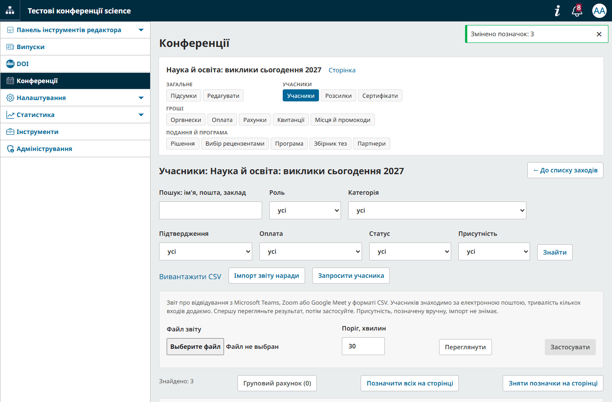

Від присутності залежить, чи отримають слухачі й доповідачі сертифікат.

## 14. Сертифікати й свідоцтва

**Шаблони.** На сторінці **Конференції** натисніть **Шаблони сертифікатів**.

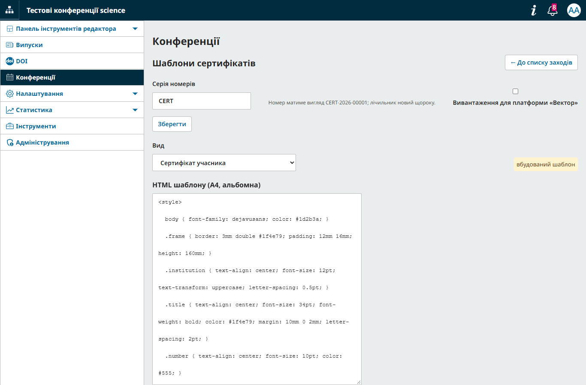

Види: сертифікат учасника, доповідача, слухача, подяка організатору й рецензенту, а для профілю «Україна» ще свідоцтво про підвищення кваліфікації. Вбудований шаблон (A4, альбомний, з QR-кодом) можна змінити, змінні вставляються натиском, **Попередній перегляд** показує результат, **Повернути вбудований** скасовує зміни. **Серія номерів** за замовчуванням `CERT` (номер `CERT-2026-00001`). Там само вмикається вивантаження для «Вектора».

**Видача.** Розділи видання → **Сертифікати**.

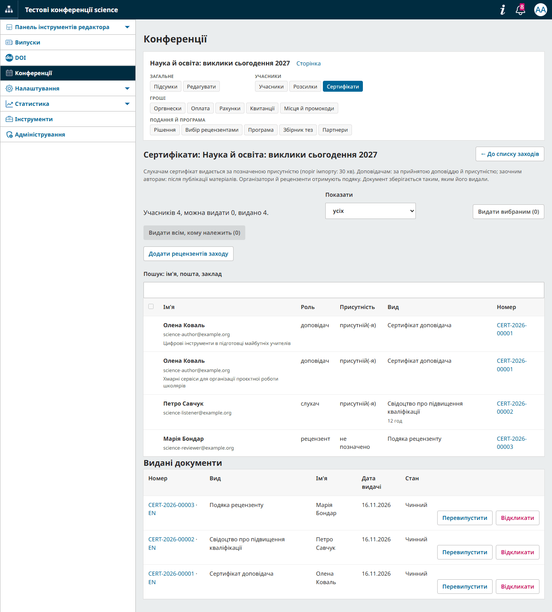

1. Натисніть **Додати рецензентів заходу**, щоб рецензенти отримали подяку.
2. Перевірте стовпець **Вид**: для кожного видно, який документ йому належить. Слухач з присутністю отримує сертифікат слухача, а якщо в заході вказано години, то свідоцтво про підвищення кваліфікації. Доповідач отримує сертифікат за прийняту доповідь і присутність.
3. Натисніть **Видати всім, кому належить** або позначте людей і **Видати вибраним**.

Під таблицею список **Видані документи** з кнопками **Перевипустити** (наприклад, якщо помилка в імені) і **Відкликати** (з причиною). Ось як виглядає видане свідоцтво:

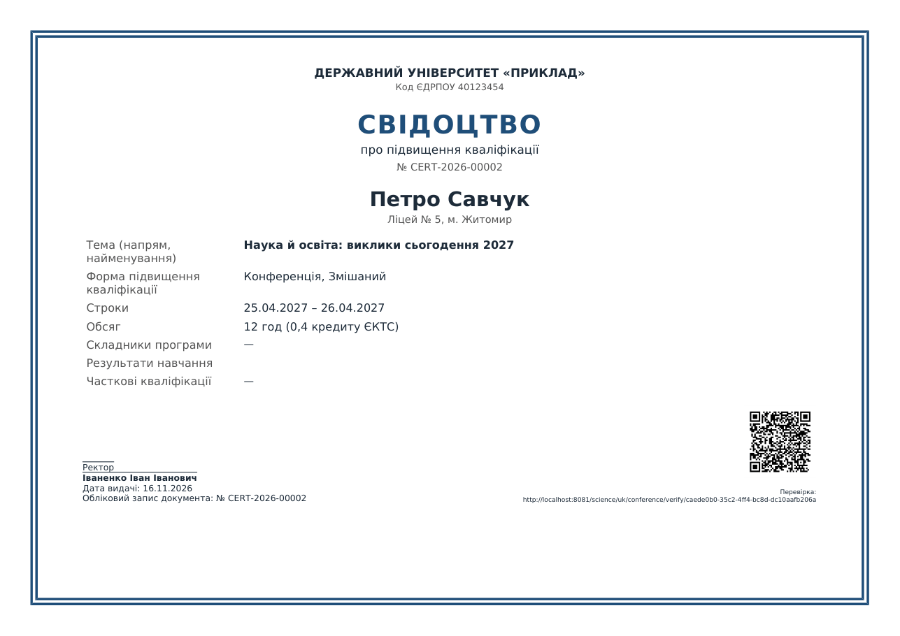

QR-код веде на публічну сторінку перевірки документа.

## 15. Збірник тез

**Де:** розділи видання → **Збірник тез**. До збірника входять прийняті доповіді, текст береться з анотації подання.

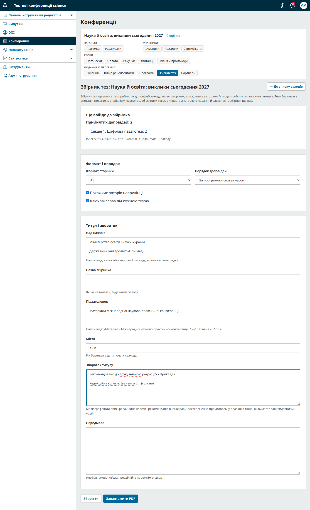

1. Перевірте блок **Що ввійде до збірника** і список доповідей без анотації.
2. Оберіть **Формат сторінки** (A5 або A4) і **Порядок доповідей** (за програмою, за секціями, за назвою), позначки **Покажчик авторів** і **Ключові слова під кожною тезою**.
3. Заповніть **Над назвою** (міністерство, заклад), **Назву збірника**, **Підзаголовок**, **Місто**, **Звороток титулу** (рекомендація вченої ради, редколегія), за потреби **Передмову**. ISBN і УДК беруться з форми видання.
4. Натисніть **Завантажити PDF**.

| Титул | Зміст | Тези |
|---|---|---|
| 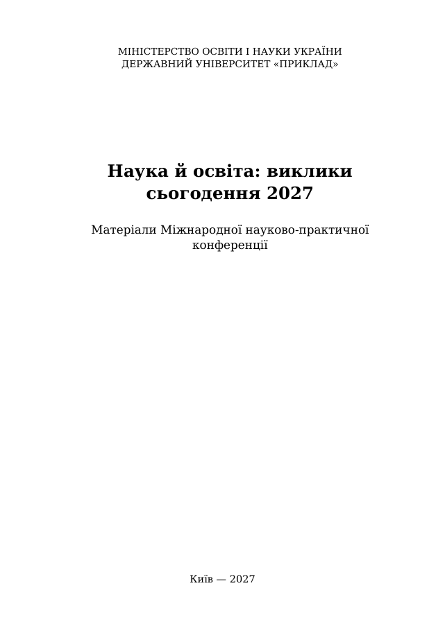 | 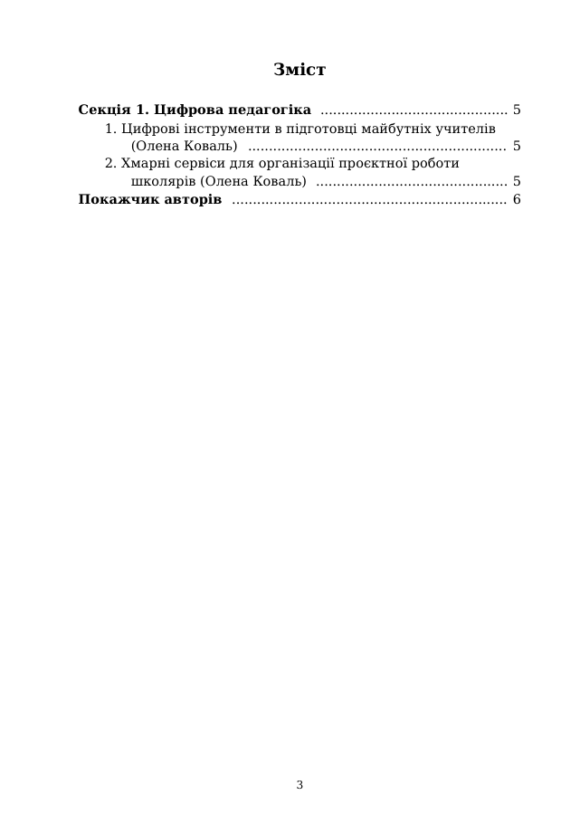 |  |

## 16. Підсумки, звіти й експорт для бухгалтерії

**Підсумки.** Розділи видання → **Підсумки**: подання за станом, прийняті за типом виступу, учасники за роллю, оплати, квитанції на перевірці, надіслані нагадування. Унизу картка **Звіти** з розрізами (секції, типи доповідей, ролі, категорії, установи, країни, форми участі) і кнопкою **Завантажити CSV**. Над картками видно, чи працює планувальник OJS.

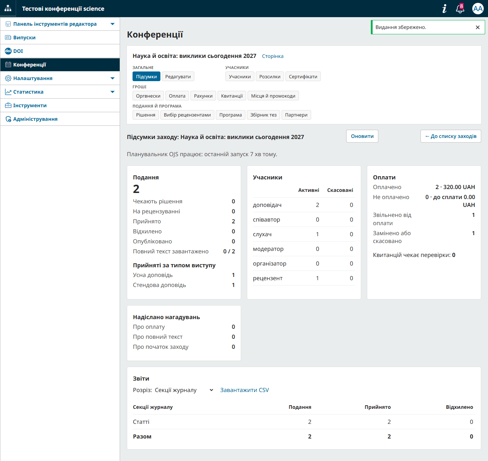

**Експорт для бухгалтерії.** Розділи видання → **Рахунки** → **Експорт для бухгалтерії**: оберіть «Лише цей захід» або «Усі заходи журналу», період і тип дати, налаштуйте колонки (**Додати колонку**, стрілки, **Зберегти колонки**) і натисніть **Завантажити CSV** або **Завантажити XLSX** (XLSX потребує PHP-розширення `zip` на сервері).

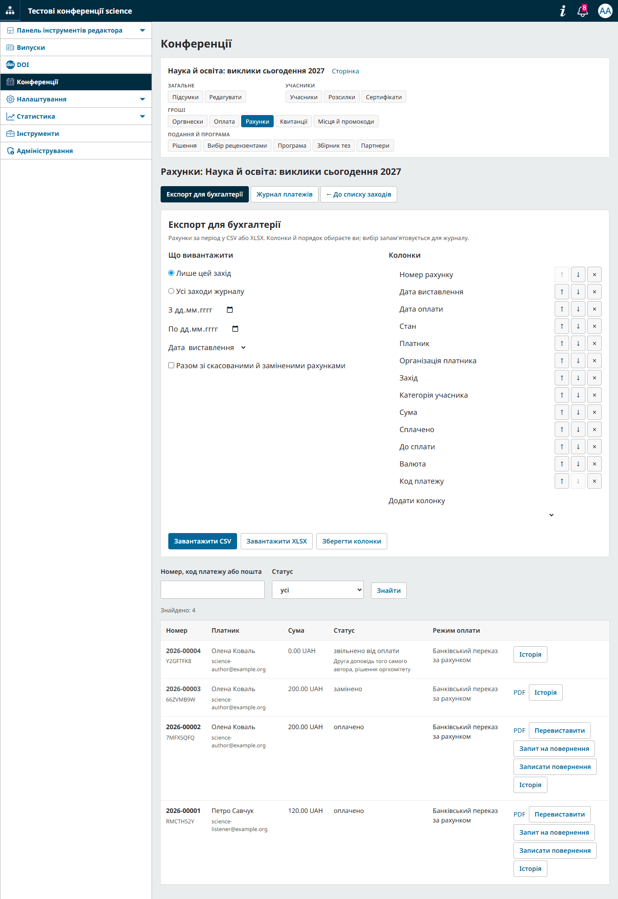

**Після заходу** змініть статус видання на «Проведено», а після публікації матеріалів на «Матеріали опубліковано». На сторінці **Конференції** також є **Журнал дій** (хто що змінював, версії тексту згоди) і **Персональні дані** (строки зберігання, вивантаження чи знеособлення даних за запитом особи).

## 17. Публічна частина: сайт конференцій

Без цього режиму відвідувачі бачать стандартний сайт журналу OJS: «Поточний випуск», «Про журнал», «Цей журнал поки не опублікував жодного випуску». Режим «сайт конференцій» перетворює публічну частину журналу на сайт заходів.

**Де:** сторінка **Конференції** → рядок **Для всього журналу** → **Публічна частина**. Майстер налаштування вмикає режим сам, якщо не зняти позначку (див. [крок 2](#2-майстер-налаштування-перше-видання)). Для журналів, налаштованих до версії 0.32, увімкніть його тут.

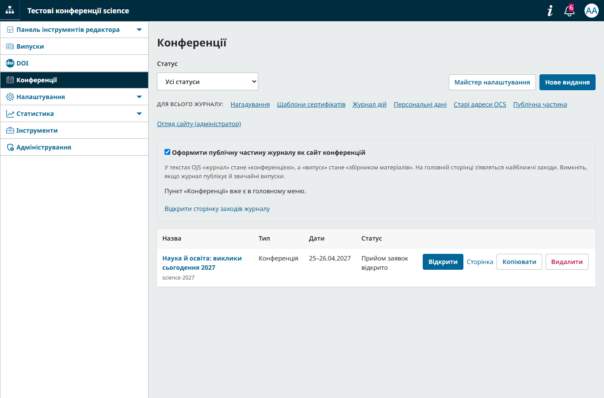

- Позначка **Оформити публічну частину журналу як сайт конференцій** вмикає режим. Тексти OJS говорять про конференцію замість журналу й про збірник матеріалів замість випуску: **Про конференцію**, **Поточний збірник**, **Архів матеріалів**, **Оргкомітет**, «Конференція ще не опублікувала жодного збірника матеріалів».
- Кнопка **Додати пункт «Конференції» в головне меню** ставить пункт першим у головне меню сайту. Якщо пункт уже є, замість кнопки видно напис «Пункт «Конференції» вже є в головному меню». Пункт можна перемістити чи прибрати в **Налаштування → Вебсайт → Меню навігації**: серед типів пунктів є «Конференції».
- **Відкрити сторінку заходів журналу** веде на `/{журнал}/conference`.

На головній сторінці журналу з'являється блок **Найближчі заходи** (у темах Default і Manuscript; тема Health Sciences не має місця для нього):

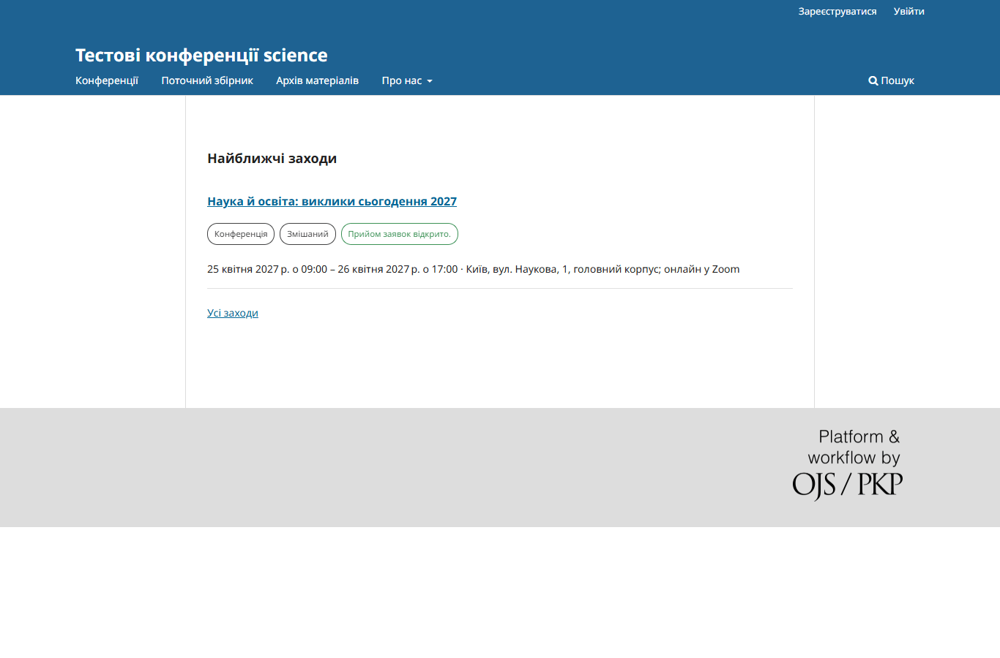

Пункт **Конференції** відкриває список усіх заходів журналу: спершу найближчі й поточні, потім минулі. Чернетки не показуються.

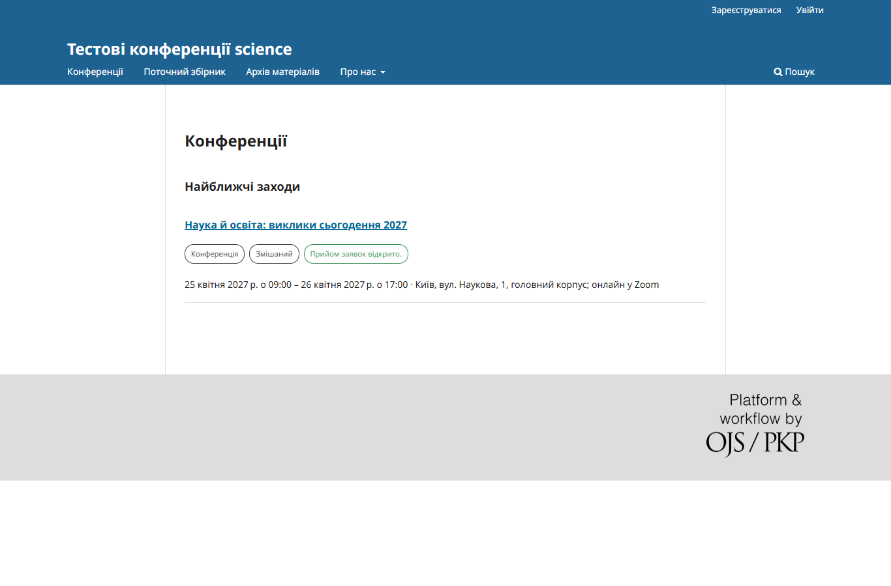

Режим діє лише на цей журнал. Вимкніть його, якщо журнал публікує й звичайні випуски: тоді повертаються стандартні тексти OJS.

---

# Частина 2. Учасник: автор і слухач

## 1. Обліковий запис

Для подання й реєстрації потрібен обліковий запис на сайті журналу. Натисніть **Зареєструватися** у верхньому меню і заповніть ім'я, прізвище, заклад, країну, пошту, логін і пароль, погодьтеся з політикою конфіденційності. Позначку «Так, я хочу отримувати запити на рецензування» ставлять лише рецензенти.

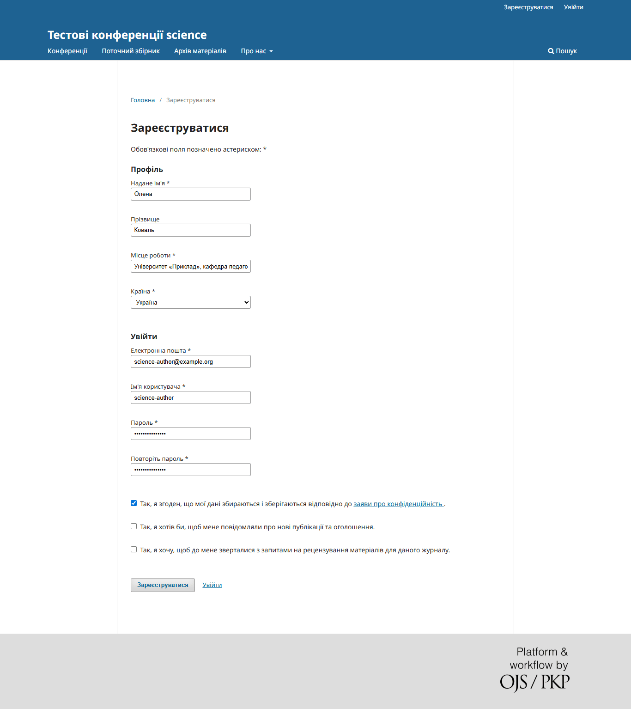

## 2. Сторінка заходу

Посилання на сторінку заходу є в інформаційному листі, а на сайті її можна знайти через пункт **Конференції** в головному меню або блок **Найближчі заходи** на головній сторінці. Тут дати, місце, вікна прийому, обсяг у годинах, умови участі, а також кнопки **Подати тези** (поки відкрито прийом) і **Зареєструватися як слухач** (поки відкрито реєстрацію).

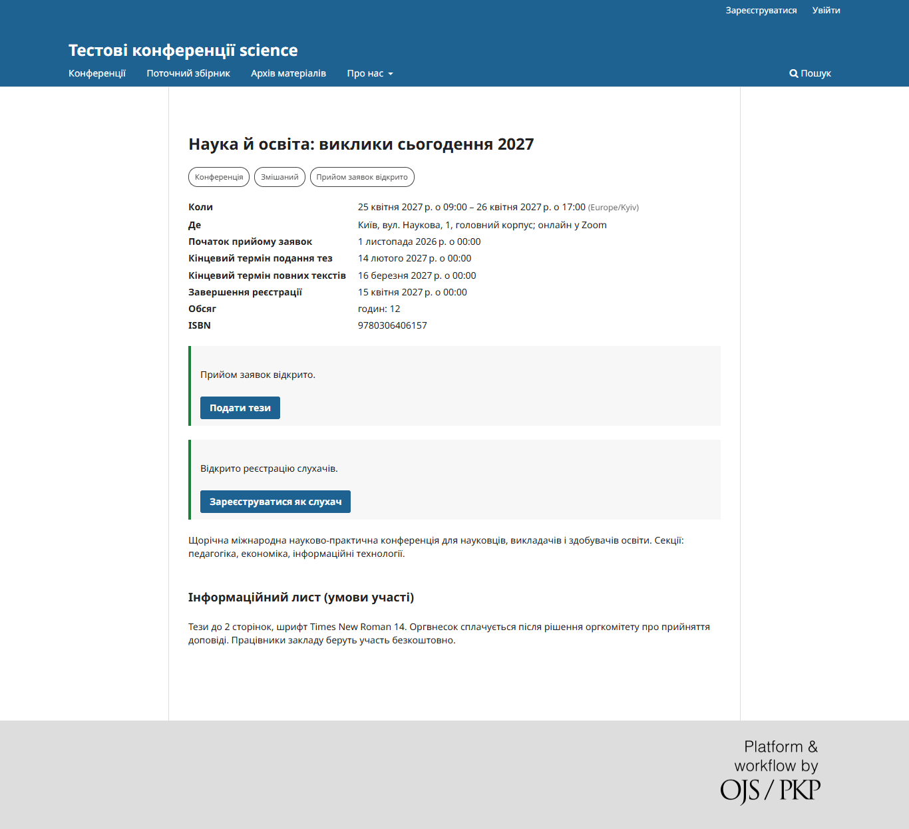

## 3. Як подати тези

1. Натисніть **Подати тези**. Оберіть **Мову подання**, впишіть **Заголовок**, підтвердьте вимоги й згоду на обробку даних, натисніть **Почати подачу**.

   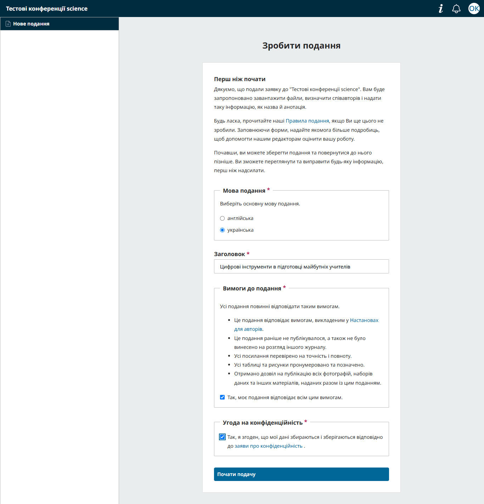

2. **Подробиці:** анотація (саме вона потрапить у збірник тез), ключові слова. **Продовжити**.
3. **Завантажити файли:** додайте файл тез і вкажіть тип «Текст статті».

   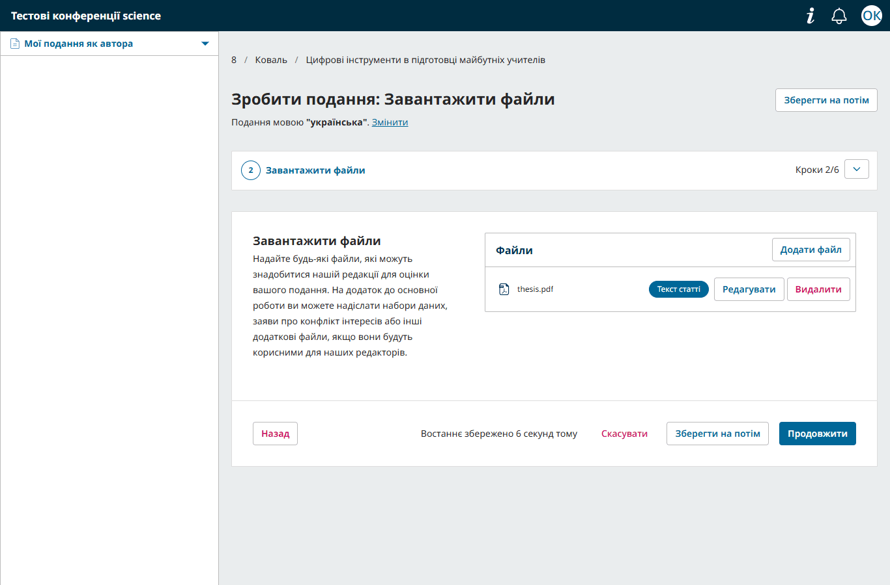

4. **Автори:** перевірте себе й додайте всіх співавторів із правильною поштою. Співавтори отримають лист для підтвердження участі.

   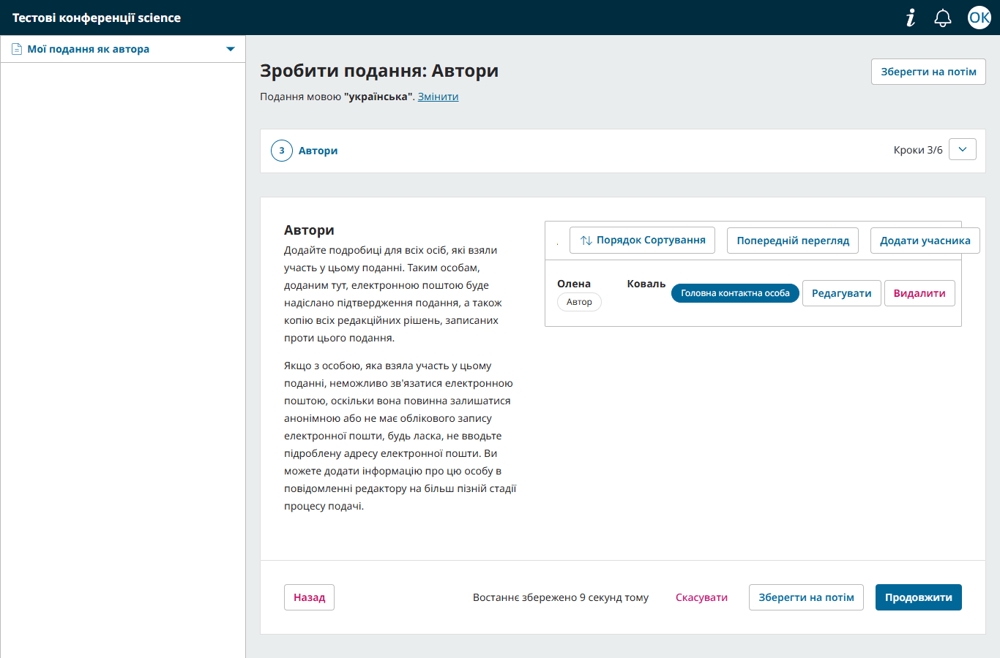

5. **Для редакторів:** за потреби коментар.
6. **Участь у конференції** (крок плагіна). Заповніть анкету доповідача:
   - **Захід**: ваш захід (видно лише ті, на які зараз приймають матеріали);
   - **Категорія учасника**: від неї залежить оргвнесок;
   - **Бажаний тип доповіді**: усна, стендова, онлайн, заочна;
   - **Форма участі**: очно, онлайн, заочно;
   - **Хто доповідає**: пошта доповідача точно як у списку авторів;
   - для неповнолітнього доповідача позначка віку й згода батьків чи законного представника;
   - **Згода на обробку персональних даних**.

   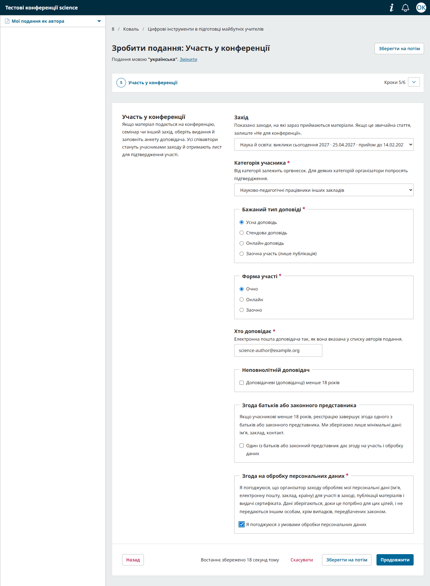

7. **Рецензія:** перевірте всі відповіді й натисніть **Подати**, потім підтвердьте.

   

Після рішення оргкомітету ви отримаєте лист. Якщо доповідь прийнято й участь платна, у кабінеті з'явиться рахунок.

> Відповіді кроку «Участь у конференції» зберігаються одразу, щойно ви їх змінюєте. Подання можна зберегти на потім, закрити вкладку чи піти через меню: коли ви повернетеся, захід, категорія, тип доповіді, форма участі й згода будуть на місці.

## 4. Як зареєструватися слухачем

Натисніть **Зареєструватися як слухач** на сторінці заходу. Ім'я й пошта беруться з облікового запису. Заповніть **Категорію учасника**, **Форму участі**, **Заклад** і **Посаду**, згоду на обробку даних і, якщо є, **Промокод**. Натисніть **Зареєструватися**.

## 5. Кабінет учасника: рахунок і оплата

Після реєстрації відкривається кабінет **Мої участі в заходах** (`/{журнал}/conference/my`). Тут роль, форма участі, категорія, промокод, вхідний квиток, лист-запрошення й рахунки.

1. Натисніть **Завантажити рахунок (PDF)**.

   

2. Сплатіть за реквізитами IBAN у банку чи інтернет-банкінгу. **Призначення платежу** вкажіть точно як у рахунку. Переказ на номер картки не є оплатою на рахунок закладу. Якщо організатори ввімкнули оплату карткою, біля рахунку є кнопка **Оплатити карткою**.
3. Якщо платить організація, розгорніть **Реквізити платника**, оберіть «Організація», впишіть назву й ЄДРПОУ, натисніть **Зберегти реквізити**.
4. У блоці **Надіслати квитанцію або платіжне доручення** оберіть файл (PDF, JPG або PNG до 5 МБ) і натисніть **Надіслати**. Стан квитанції («Очікує перевірки», «Прийнято», «Відхилено») видно в кабінеті.

## 6. Вхідний квиток і лист-запрошення

Для очної участі в кабінеті є блок **Вхідний квиток (QR-код)**. Покажіть його на реєстрації заходу. **Відкрити квиток на весь екран** зручно для телефона.

**Лист-запрошення (PDF)** (і посилання **англійською**) на бланку закладу можна показати за місцем роботи, наприклад для відрядження. Доповідачі отримують його після прийняття доповіді.

## 7. Програма й модерування сесії

Коли програму опубліковано, на сторінці заходу з'являється посилання на неї. Учасник, який увійшов, бачить кнопку **До моєї програми** біля сесій, посилання **Лише моя програма** і може завантажити календар (iCal) чи PDF.

Модератор сесії бачить у кабінеті розділ **Сесії, які я модерую**. На сторінці сесії він позначає присутніх і натискає **Зберегти присутність** або завантажує звіт онлайн-наради.

## 8. Сертифікат і його перевірка

Коли оргкомітет видасть документ, він з'явиться в кабінеті в розділі **Мої сертифікати**: **Завантажити PDF**, **Завантажити (EN)**, **Сторінка перевірки**.

Будь-хто може перевірити документ за QR-кодом або на сторінці `/{журнал}/conference/verify`:

Скасувати участь можна кнопкою **Скасувати участь** у кабінеті до дати, вказаної поруч. **Завантажити мої дані (JSON)** віддає все, що плагін зберігає про вас.

---

# Частина 3. Рецензент

Рецензентом стає користувач із роллю «Рецензент» у журналі (позначка під час реєстрації облікового запису або призначення менеджером).

## 1. Вибір подань

Коли оргкомітет відкриє вибір, прийде лист «Оберіть подання для рецензування». Те саме посилання є в кабінеті `/{журнал}/conference/my` у розділі **Вибір подань для рецензування**.

Біля кожного подання (назва, секція, ключові слова, **Анотація**, без імен авторів) оберіть **дуже хочу**, **можу**, **не хочу** або **конфлікт інтересів** і натисніть **Зберегти вибір**. Змінювати вибір можна до дати, вказаної на сторінці.

## 2. Рецензія

Коли вам призначать подання, прийде лист «Запит на рецензію». Далі все відбувається звичайними засобами OJS:

1. **Запит:** перегляньте назву, анотацію й строки, погодьтеся з політикою конфіденційності й натисніть **Погодитися на рецензування** (або **Відхилити запит**).

   

2. **Довідник:** настанови журналу для рецензентів.
3. **Завантажити та рецензувати:** завантажте файл, напишіть коментар для автора й редактора (і, за потреби, лише для редактора), оберіть **Рекомендацію**, натисніть **Надіслати рецензію** і підтвердьте.

   

Після заходу рецензенти, які завершили рецензію, отримують подяку від оргкомітету.

---

## Шпаргалка: що заповнити обов'язково

| Що | Де | Без цього |
|---|---|---|
| Повна назва, ЄДРПОУ, адреса закладу | Профіль закладу | порожні рахунки й сертифікати |
| Підписант із позначеними документами | Профіль закладу → Підписанти | документи без підпису |
| Активний рахунок (IBAN) | Профіль закладу → Платіжні реквізити | майстер не створить правил оплати переказом |
| Дати прийому заявок | Форма видання | кнопка «Подати тези» не з'явиться |
| Статус «Прийом заявок відкрито» | Форма видання | подання не приймаються |
| Тарифи для кожної платної категорії | Оргвнески | рахунок не виставиться |
| Правило оплати для категорії або «Усі інші» | Оплата | рахунок не виставиться |
| Обсяг, годин | Форма видання | свідоцтва про підвищення кваліфікації не буде |
| Присутність | Учасники | сертифікати слухачам і доповідачам не належать |
| Позначка «Опублікувати програму» | Форма видання → Програма заходу | учасники не бачать програми |

## Типові проблеми

- **Немає кнопки «Подати тези».** Статус видання не «Прийом заявок відкрито» або зараз поза вікном між початком прийому й кінцевим терміном.
- **Доповідачу не виставився рахунок.** Для його категорії немає тарифу на цей матеріал або правило оплати «Безкоштовно».
- **Подання не надсилається.** Не обрано захід чи категорію, не вказано форму участі, пошта доповідача не збігається з поштою в списку авторів, немає згоди на обробку даних.
- **Не приходять нагадування, не закривається прийом, не йде розсилка.** Не налаштовано планувальник OJS (cron). Попередження про це видно на сторінці **Підсумки**.
- **На сайті написано «журнал» і «випуск», а в меню немає «Конференцій».** Не ввімкнено режим сайту конференцій: **Конференції** → **Публічна частина** (див. [крок 17](#17-публічна-частина-сайт-конференцій)).
- **Помилка в імені на виданому сертифікаті.** Виправте дані учасника й натисніть **Перевипустити**: старий документ буде відкликано, новий отримає новий номер.

---

Знімки екрана зроблено на тестовому сайті з вигаданими даними. Щоб оновити їх після зміни інтерфейсу, запустіть `ci/docs/walkthrough.sh` на тестовому стенді: скрипт створює окремий журнал, проходить увесь цикл через інтерфейс і записує знімки в `docs/uk/img/walkthrough`.
